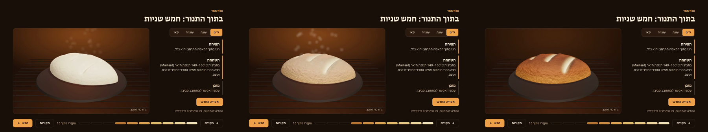
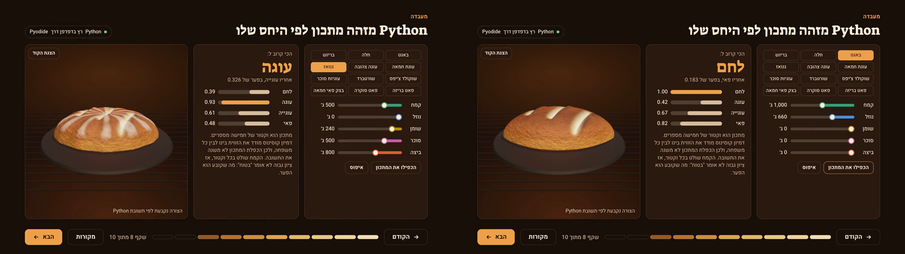
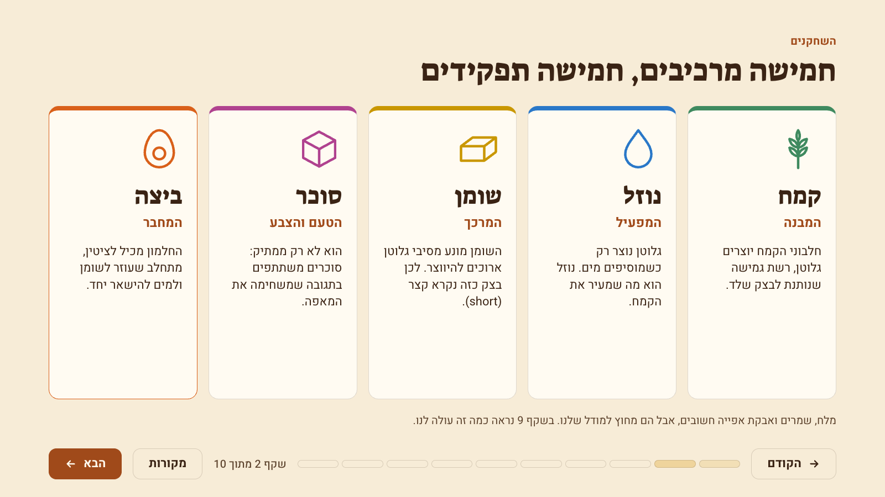
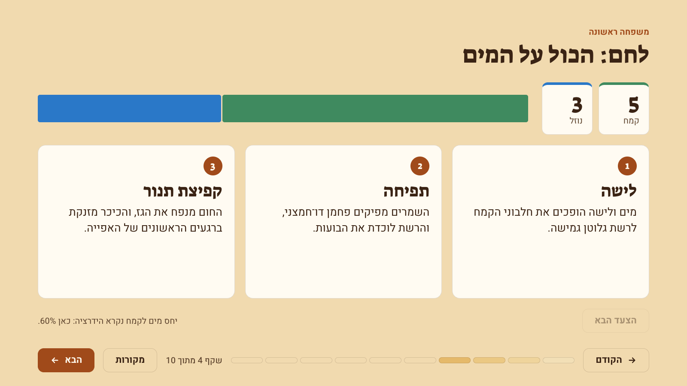
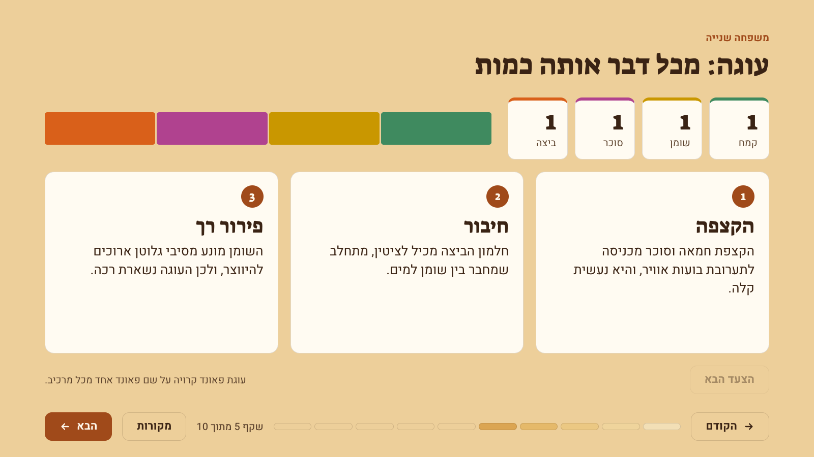
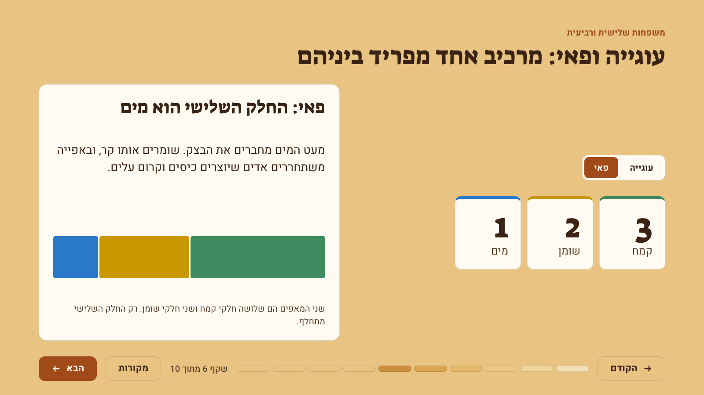
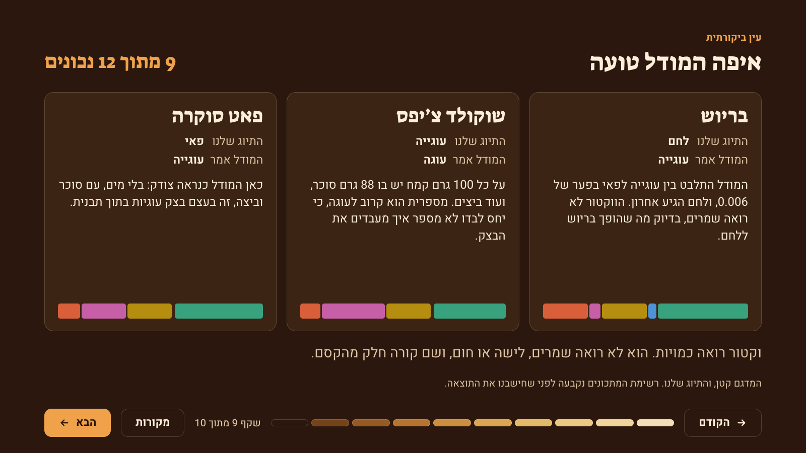
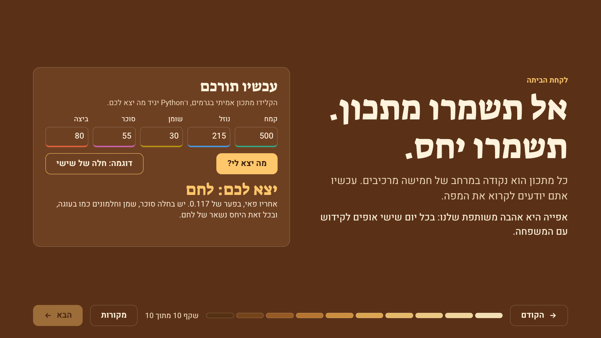
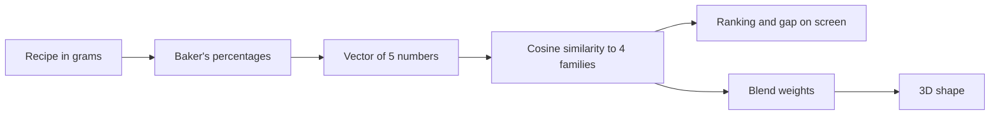
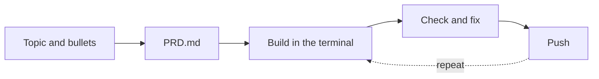

# Same Five Ingredients (אותם חמישה מרכיבים)

A Hebrew, right-to-left, interactive HTML presentation on baking, with JavaScript, Python and an animated 3D object built with Three.js.

Assignment 01, Generative AI course, Bar-Ilan University, Dr. Yoram Segal. Group `biu-noa7`.


## Goal

Show that **bread, cake, cookies and pie are the same five ingredients in different ratios**, and test that claim instead of only stating it. The audience reads a recipe as a vector, watches Python classify it, sees the result bake in 3D, and then sees where the method fails.

## Why this topic

We both love to bake. We do it every Friday for our kiddush with the family, so we know this subject well enough to catch a wrong claim about it. Slide 10 ends on a Friday challah.

## What this repository does

It holds the presentation and everything behind it: the Python classifier, 12 published test recipes, the automated checks, the product requirements document and the prompts used to build it.

## How to run it

Open `index.html` in a browser by double-clicking it. There's nothing to install.

- **Navigate:** use the **הבא** and **הקודם** buttons, the progress strip, or the arrow keys. The left arrow advances, following Hebrew reading direction.
- **Internet:** needed for Google Fonts, Three.js and Pyodide. If Python can't load, the lab keeps working on its presets from results computed in advance, and the status chip says so.
- **Screen:** designed for laptops and projectors, in landscape.

## Demo video

[](assets/demo.mp4)

[Watch the full 57-second video](assets/demo.mp4). It's a screen capture of the real deck.

Frames from the video, showing the bake from raw dough to crust:



And the lab, where Python's answer changes the object. Genoise reads as cake, and a doubled baguette still reads as bread:



## What to test

Each row is one control to try and what it should do.

| Slide | Try this | Expected result |
|---|---|---|
| Any | **הבא**, or the left arrow | The next slide opens, and the strip fills from the right |
| Any | **מקורות** | The sources panel opens from the left |
| 2 | Click an ingredient card | Its job is revealed |
| 3 | **10 כיכרות** | Grams change to 5,000 and 3,000, and the percentages stay 100% and 60% |
| 4, 5 | **הצעד הבא** | The next step lights up |
| 6 | **פאי** | The third ingredient changes from sugar to water |
| 7 | **אפייה מחדש**, then drag the object | The bake finishes in under 5 seconds, and the object rotates |
| 8 | **בריוש** | A near-tie between cookie and pie, and an in-between shape |
| 8 | **הכפילו את המתכון** | Grams double, and the answer doesn't change |
| 8 | Move a slider | Python answers again, and the shape follows |
| 8 | **הצגת הקוד** | The Python that's running appears |
| 10 | **דוגמה: חלה של שישי** | The form fills in, and Python answers bread |

## All 10 slides

| | |
|---|---|
|  **1. The claim** |  **2. Five ingredients, five jobs** |
|  **3. Baker's percentage** |  **4. Bread** |
|  **5. Cake** |  **6. Cookie and pie** |
|  **7. The oven (3D)** |  **8. Python lab** |
|  **9. Where it breaks** |  **10. Your turn** |

## Beyond the requirements

- **One argument, not a recipe collection.** Every slide serves the same claim.
- **Python does a real job.** It applies cosine similarity from the course to a new problem: recipes as vectors, where ignoring size matches how baker's percentages ignore batch size.
- **The 3D object is the answer.** Python's numbers set its shape directly, so the two aren't separate decorations.
- **The deck reports its own failures.** Slide 9 shows where the method is wrong and what a vector can't see.
- **The deck bakes as you advance.** Each slide is one shade browner, from raw dough to dark crust, and the progress strip browns with it.
- **Alignment is tested, not assumed.** The RTL audit measures it in two browser engines.

## Work specification

| Item | Specification | Where |
|---|---|---|
| Presentation | One HTML file, 10 slides, a Fancy design | `index.html` |
| Language | Hebrew, RTL end to end, BiDi for English terms and numbers | Whole deck |
| Fonts | Suez One and Heebo, from Google Fonts | Whole deck |
| JavaScript | Navigation, reveals, toggles, sources panel, lab controls | Inline in `index.html` |
| Python | Classifies a recipe with cosine similarity, running in the browser through Pyodide | Slides 8, 9, 10 |
| 3D animation | Three.js, one mesh with four morph targets, bake under 5 seconds | Slides 7, 8 |
| Data | 12 published recipes, 3 per family, with sources | `python/sourced_recipes.py` |
| Failure handling | Results computed in advance if Python can't load, a still image if 3D can't | Slides 7, 8 |
| Testing | 53 browser checks in Chrome and Safari's engine, and 13 Python tests | `tests/` |
| Documents | README, PRD and prompt log | Repository root and `prompts/` |

The full plan, acceptance tests and decision log are in [`PRD.md`](PRD.md).

## How Python and the 3D object connect



`python/recipe_vectors.py` turns grams into baker's percentages, so batch size disappears. It treats the recipe as a five-dimensional vector and measures its cosine similarity to four reference ratios from Michael Ruhlman's *Ratio*: bread 5:3, pound cake 1:1:1:1, cookie 3:2:1, pie dough 3:2:1. The same file runs in the page and on the command line, and a test fails if the two copies differ.

The 3D object is one piece of dough with four morph targets. Python's blend weights set those targets directly, so a near-tie looks like an in-between pastry. Everything is built from code, with no image assets. It isn't a doughnut, because that's the lecture's own example.

## Python output

Python running in the page, classifying a recipe live:


Output of `python3 python/make_charts.py` on the 12 published recipes:

```text
Recipe              Labeled  Closest   Score  Runner-up     Gap
Baguette            bread    bread     0.999  pie         0.183
Challah             bread    bread     0.974  pie         0.117
Brioche             bread    cookie    0.892  pie         0.006  <- miss
Yellow butter cake  cake     cake      0.830  pie         0.046
Yellow cake         cake     cake      0.830  cookie      0.040
Genoise             cake     cake      0.932  cookie      0.326
Toll House cookie   cookie   cake      0.928  cookie      0.013  <- miss
Shortbread          cookie   cookie    1.000  pie         0.065
Sugar cookie        cookie   cookie    0.942  cake        0.027
Pâte brisée         pie      pie       0.993  cookie      0.074
Pâte sucrée         pie      cookie    0.962  cake        0.062  <- miss
All-butter crust    pie      pie       0.998  cookie      0.081

9 of 12 correct
```


**How to read 9 of 12.** The recipe list was fixed before any score was computed. It's still a small sample, and the family labels are ours. Flour dominates every vector, so scores run high, and the gap between first and second means more than the score. The misses are informative:

- **Brioche** split between cookie and pie, and bread came last. The vector can't see yeast, which is what makes brioche a bread.
- **Toll House** is high in sugar and has eggs, so its numbers are near cake. A ratio doesn't say how the dough is handled.
- **Pâte sucrée** has no water, plus sugar and egg. The model is probably right that this is cookie dough in a tart tin.

## RTL and BiDi

"Every component aligned" was a team requirement, so it's measured and not only checked by eye. `tests/check_deck.mjs` opens the real deck and confirms all of this:

- Every Hebrew text block computes as RTL, and English inside Hebrew is isolated so that sentences can't reorder.
- Headers and content share one right edge, and nothing crosses a gutter or the bottom bar.
- Rows read from the right. Next sits on the left, and the left arrow advances.
- Sliders and score bars grow from the right toward the left.
- The stylesheet has no physical left or right properties. Code is the one deliberate exception, and it stays LTR in its own isolated block.

Eight heading and four body fonts were rendered with the deck's real text before choosing **Suez One** and **Heebo**.

## How we worked

We followed the lecture's loop, and repeated steps 3 to 5 several times:



| Stage | The team | The model (Claude Code) |
|---|---|---|
| Planning | Chose the topic from their own Friday baking, set the main points, accepted the PRD | Proposed the rest of the points, wrote the PRD |
| Building | Set the requirements: Hebrew, RTL end to end, every component aligned, Google Fonts | Wrote the code and the files |
| Checking | Reviewed the finished deck | Wrote and ran the tests, and fixed what they found |
| Documenting | Made the repo public, asked for this README to be checked against the assignment | Wrote the README, pushed each stage |

The team also asked the model to choose the recipe on slide 10. It picked a published challah and didn't invent a personal story.

The real prompts are in [`prompts/`](prompts/), in order.

### What each push changed

| Push | What changed |
|---|---|
| `887c01a` | First version of the plan: PRD and prompt log |
| `458a818` | First Hebrew deck, all 10 slides, classifier, RTL audit |
| `3a253a9` | 3D oven, live Python lab, brioche claim corrected |
| `c304cb7` | Recipe data verified at the source, colors rebuilt, README, video |
| `b198d75` | Challah on slide 10, team review recorded, repo public |
| `9cbd4f8` | New screenshots and video frames, self grade recorded. Its message wrongly says the README changed, because that write had failed |
| `f55ed48` | README rebuilt against the assignment text |
| `779b96b` | Section restored on what goes beyond the requirements |
| `56cce0a` | Prompt log updated |
| Latest | The team's Friday baking added, and the PRD's points split by who gave them |

### What checking caught

| What was wrong | How it was caught | What changed |
|---|---|---|
| A score of 10 of 12 came from recipes recalled from memory | The PRD required published sources | 9 of 12 is the figure now used |
| Slide 9 said brioche lost to bread by 0.006 | Comparing the sentence to the data: the gap is cookie against pie, and bread came last | Slide rewritten, and a test now holds every claim on that slide |
| Toll House used a sifted flour weight, and "more sugar than flour" depended on it | Reading the source directly: it concludes 360 g, not 280 g | Data and slide corrected |
| Flour and fat were nearly the same color | A color check on every pair: they touch in cake and cookie bars | New validated palette, with its own set for dark slides |
| Opening the sources panel pushed the whole deck 28px sideways | The RTL audit | Stage clipping fixed |
| The audit stopped early and looked clean | Noticing that its summary line was missing | Wait fixed, and a run now counts only if the summary prints |
| The 3D loaf was cropped in the lab, and a drag carried over between slides | Reviewing screenshots | Camera now fits the panel and resets per slide |
| The README left out items from the assignment | Re-reading the assignment line by line | This version |

### Token economics

- Prompts and documents are in English, because the lecture puts Hebrew at about 2.5 times the tokens.
- The video is a screen capture, because animating objects carries the same message for far fewer resources than a video model.
- The deck stops at 10 slides, since more slides cost more without adding value.
- Python uses only the standard library, so the page downloads no extra packages.

## Concepts used

| Concept | Meaning | Where it appears |
|---|---|---|
| Fancy | A keyword for an impressive, designed look | The whole deck, which browns from dough to crust |
| RTL | Right-to-left page direction | The whole deck |
| BiDi | Correct mixing of two text directions in one sentence | English terms and numbers inside Hebrew |
| Single file | Everything in one `index.html` | The deck |
| Three.js | An engine for 3D objects in a web page | Slides 7, 8 |
| Pixels and objects | A movie is many images, and animation is many graphics, which is why objects are cheaper | The 3D bake |
| Vector | A list of numbers that represents something | A recipe as 5 numbers |
| Cosine similarity | Compares direction and ignores size | Doubling a recipe doesn't change the answer |
| PRD | The plan written before the work | `PRD.md` |
| Push | A saved version on GitHub | The table above |

## Tests

```bash
pytest tests                                  # 13 Python tests
cd tests && npm install --ignore-scripts
npm run check                                 # 53 browser checks in Chrome
npx playwright install webkit
BROWSER=webkit npm run check                  # the same checks in Safari's engine
```

## Repository

```text
index.html                 the presentation
README.md                  this file
PRD.md                     plan, acceptance tests, decision log
prompts/                   the real prompts, in order
python/recipe_vectors.py   the classifier, also what runs in the page
python/sourced_recipes.py  the 12 published recipes, with sources and conversions
python/inline_python.py    copies the classifier into index.html
python/make_charts.py      the table and chart above
tests/                     browser audit, Python tests, demo recorder
assets/                    screenshots, chart, video
```

Sources for every fact and recipe are in the deck's **מקורות** panel and in `python/sourced_recipes.py`.
