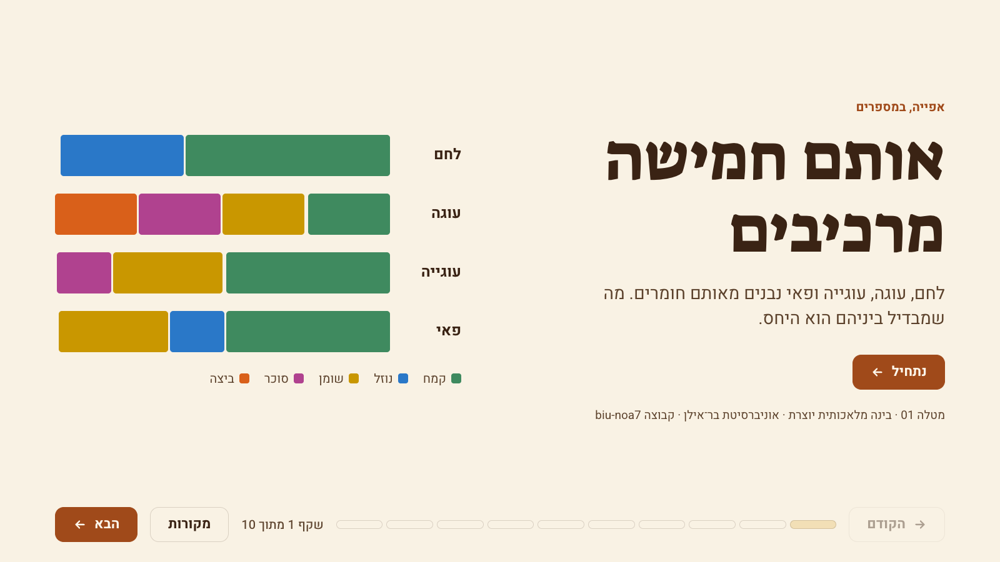
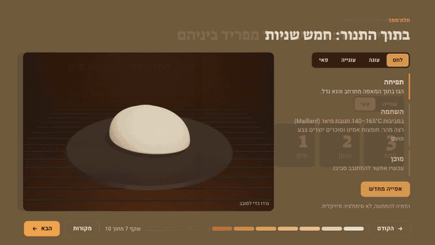
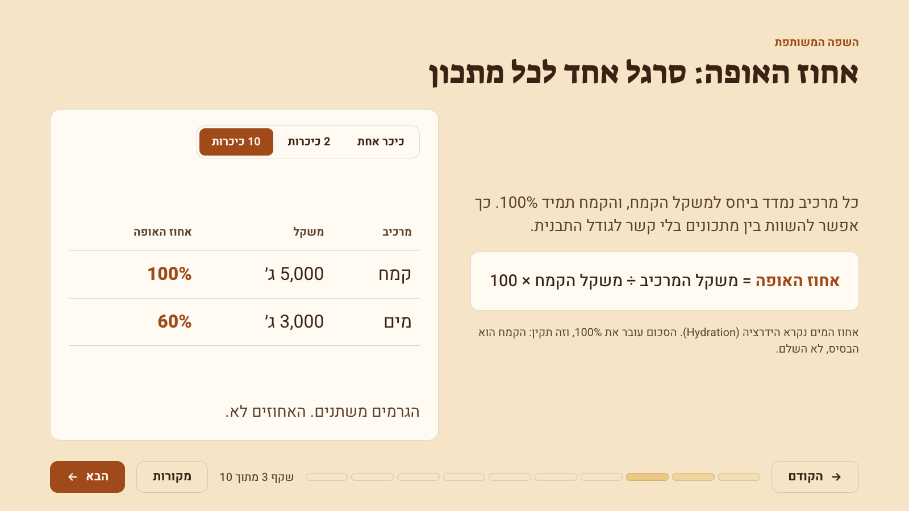
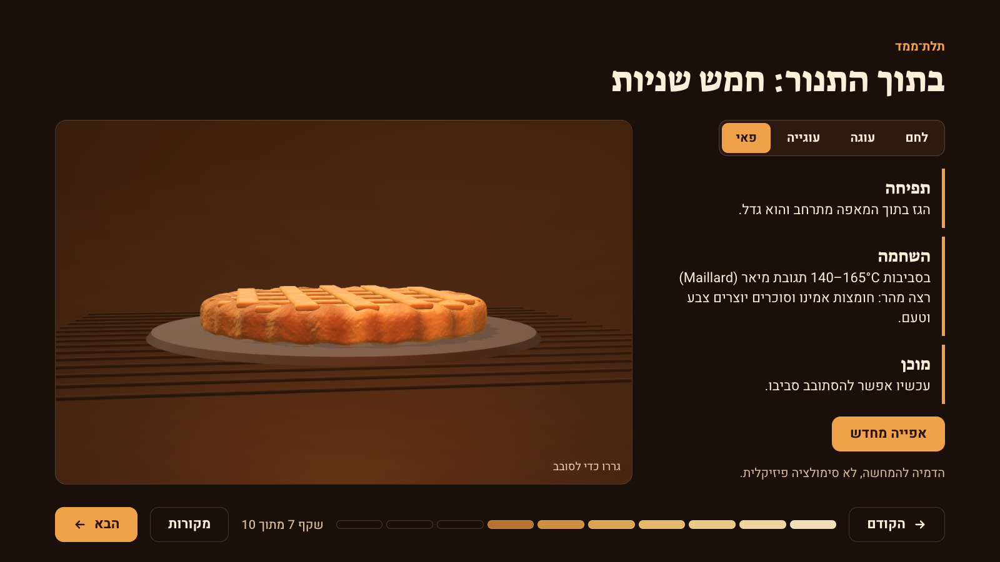
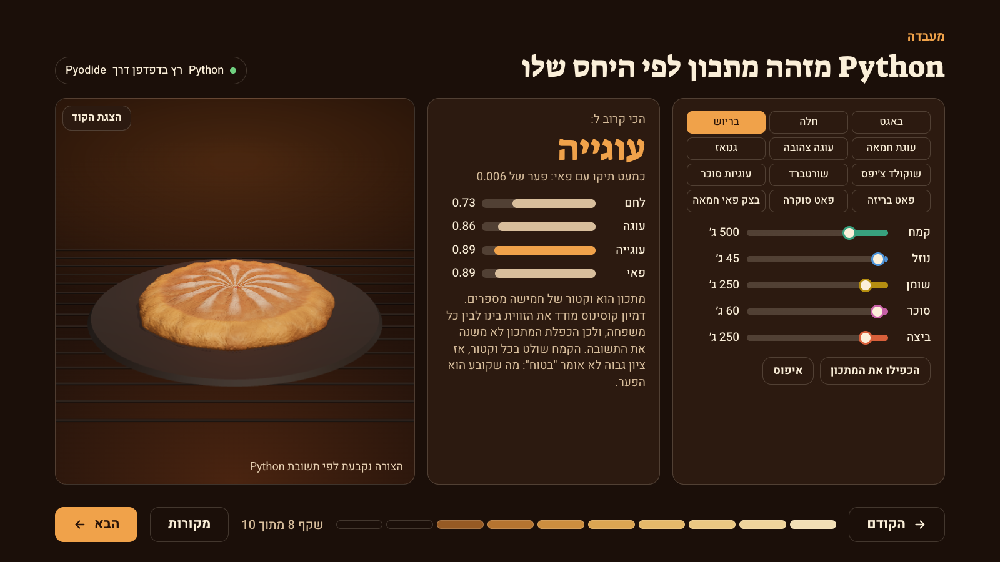
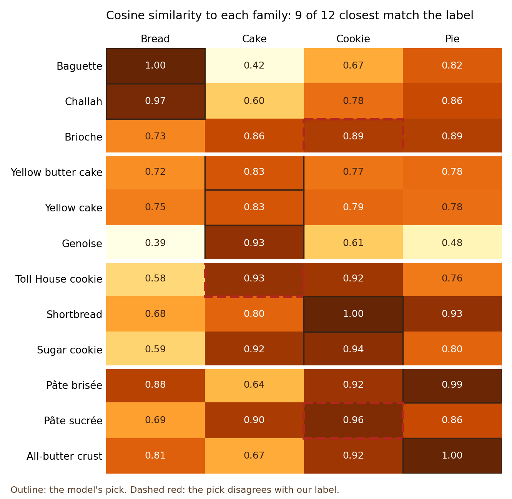

# Same Five Ingredients (אותם חמישה מרכיבים)

A Hebrew, right-to-left, interactive presentation with one argument: **bread, cake, cookies and pie are the same five ingredients in different ratios.** Python reads any recipe as a vector and finds its family, and a 3D object bakes into the answer.

Assignment 01, Generative AI course, Bar-Ilan University, Dr. Yoram Segal. Group `biu-noa7`.



## Run it

Open `index.html` in a browser, by double-clicking it. There's nothing to install.

- **Keys:** the left arrow advances and the right arrow goes back, following Hebrew reading direction. The buttons and the progress strip work too.
- **Internet:** needed for Google Fonts, Three.js and Pyodide. If Python can't load, the lab keeps working on its presets from results computed in advance, and the status chip says so.
- **Screen:** designed for laptops and projectors, in landscape.

## Demo

[](assets/demo.mp4)

[Watch the full 57-second video](assets/demo.mp4). It's a screen capture of the real deck, not an AI-generated video. That follows the lecture's token-economics point: animating objects carries the message for far fewer resources.

## What's different about it

- **One argument, not a recipe collection.** Every slide serves the same claim.
- **Python does a real job.** It runs in the browser through Pyodide, using the same file as this repo, and classifies recipes with the cosine similarity taught in lecture 3.
- **The 3D object is the answer.** One mesh morphs from dough into four shapes, and Python's numbers set the morph weights directly. A near-tie looks like an in-between pastry.
- **It's not a doughnut.** That's the lecture's own example, so the bake itself is the subject here.
- **The deck reports its own failures.** Slide 9 shows where the method is wrong and why.
- **The deck bakes as you advance.** Each slide is one shade browner, from raw dough to dark crust.

## The slides

| # | Slide | What you can do |
|---|---|---|
| 1 | The claim | Start |
| 2 | Five ingredients, five jobs | Click each one to reveal its job |
| 3 | Baker's percentage | Change the batch: grams move, percentages don't |
| 4 | Bread | Step through kneading, rising and oven spring |
| 5 | Cake | Step through creaming, emulsifying and tender crumb |
| 6 | Cookie and pie | Swap the one ingredient that separates them |
| 7 | The oven | Bake any family in under 5 seconds, replay, drag to rotate |
| 8 | Python lab | Pick one of 12 recipes, move sliders, double it, read the code |
| 9 | Where it breaks | See the three misses and what a vector can't see |
| 10 | Your turn | Run a Friday challah, or type a real recipe and get an answer |

| Baker's percentage | The oven | Python lab |
|---|---|---|
|  |  |  |

## Python

`python/recipe_vectors.py` turns grams into baker's percentages, so batch size disappears. It treats the recipe as a five-dimensional vector and measures the cosine similarity to four reference ratios from Michael Ruhlman's *Ratio*: bread 5:3, pound cake 1:1:1:1, cookie 3:2:1, pie dough 3:2:1. The standard library is enough, so the browser downloads no extra packages.

Output of `python3 python/make_charts.py` on the 12 published recipes in `python/sourced_recipes.py`:

```text
Recipe              Labeled  Closest   Score  Runner-up     Gap
Baguette            bread    bread     0.999  pie         0.183
Challah             bread    bread     0.974  pie         0.117
Brioche             bread    cookie    0.892  pie         0.006  <- miss
Yellow butter cake  cake     cake      0.830  pie         0.046
Yellow cake         cake     cake      0.830  cookie      0.040
Genoise             cake     cake      0.932  cookie      0.326
Toll House cookie   cookie   cake      0.928  cookie      0.013  <- miss
Shortbread          cookie   cookie    1.000  pie         0.065
Sugar cookie        cookie   cookie    0.942  cake        0.027
Pâte brisée         pie      pie       0.993  cookie      0.074
Pâte sucrée         pie      cookie    0.962  cake        0.062  <- miss
All-butter crust    pie      pie       0.998  cookie      0.081

9 of 12 correct
```



**How to read 9 of 12.** The recipe list was fixed before any score was computed. It's still a small sample, and the family labels are ours. Flour dominates every vector, so scores run high, and the gap between first and second means more than the score. The misses are informative:

- **Brioche** split between cookie and pie, and bread came last. The vector can't see yeast, which is what makes brioche a bread.
- **Toll House** is high in sugar and has eggs, so its numbers really are near cake. A ratio doesn't say how the dough is handled.
- **Pâte sucrée** has no water, plus sugar and egg. The model is probably right that this is cookie dough in a tart tin.

## 3D

Everything is built from code with Three.js, with no image assets, and every family starts from the same piece of dough. The bake is capped under the lecture's 5-second limit, runs when the slide opens, and can be replayed. Nothing renders while the slide is off screen. The slide says plainly that this is an illustration and not a physics simulation.

## RTL

"Every component aligned" was a team requirement, so it's measured and not only eyeballed. `tests/check_deck.mjs` opens the real deck and checks all of this:

- Every Hebrew text block computes as RTL, and English inside Hebrew is isolated so that sentences can't reorder.
- Headers and content share one right edge, and nothing crosses a gutter or the bottom bar.
- Rows read from the right. Next sits on the left, and the left arrow advances.
- Sliders and score bars grow from the right toward the left.
- The stylesheet has no physical left or right properties. Code is the one deliberate exception, and it stays LTR in its own isolated block.

Fonts are from Google Fonts. Eight heading and four body candidates were rendered with the deck's real text before choosing **Suez One** for headings and **Heebo** for body text.

## How it was built

The work followed the lecture's loop: bullet points, PRD, build, check and fix, push.

- **The team** chose the topic, set the requirements (Hebrew, RTL end to end, every component aligned, Google Fonts), chose where the repo lives, accepted the PRD, reviewed the finished deck and made the repo public.
- **The model** (Claude Code) drafted the bullets at the team's request, then wrote the PRD, the code and the tests. The team also asked it to choose the recipe on slide 10. It picked a published challah and didn't invent a personal story.

The real prompts are in [`prompts/`](prompts/), the plan and decision log are in [`PRD.md`](PRD.md), and each push shows what changed.

Checking found these mistakes, and they stayed in the record:

| What was wrong | How it was caught | What changed |
|---|---|---|
| A score of 10 of 12 came from recipes recalled from memory | The PRD required published sources | 9 of 12 is the figure now used |
| Slide 9 said brioche lost to bread by 0.006 | Comparing the sentence to the data: the gap is cookie against pie, and bread came last | Slide rewritten, and a test now holds every claim on that slide |
| Toll House used a sifted flour weight, and "more sugar than flour" depended on it | Reading the source directly: it concludes 360 g, not 280 g | Data and slide corrected |
| Flour and fat were nearly the same color | A color check on every pair: they touch in cake and cookie bars | New validated palette, with its own set for dark slides |
| Opening the sources panel pushed the whole deck 28px sideways | The RTL audit | Stage clipping fixed |
| The audit stopped early and looked clean | Noticing that its summary line was missing | Wait fixed, and a run now counts only if the summary prints |
| The 3D loaf was cropped in the lab, and a drag carried over between slides | Reviewing screenshots | Camera now fits the panel and resets per slide |

## Tests

```bash
pytest tests                                  # 13 Python tests
cd tests && npm install --ignore-scripts
npm run check                                 # 52 browser checks in Chrome
npx playwright install webkit
BROWSER=webkit npm run check                  # the same checks in Safari's engine
```

## Repository

```text
index.html                 the deck
PRD.md                     plan, acceptance tests, decision log
prompts/                   real prompts, in order
python/recipe_vectors.py   the classifier, also what runs in the page
python/sourced_recipes.py  the 12 published recipes, with sources and conversions
python/inline_python.py    copies the classifier into index.html
python/make_charts.py      the table and chart above
tests/                     browser audit, Python tests, demo recorder
assets/                    screenshots, chart, video
```

Sources for every fact and recipe are in the deck's sources panel and in `python/sourced_recipes.py`.
